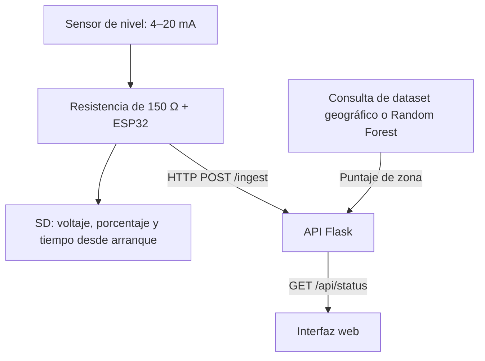

# Monitoreo de inundaciones y evaluación de riesgo geográfico en CDMX

**ESP32 · sensor de 4–20 mA · registro SD · Python/Flask · riesgo geográfico**

[English](README.md) | Español

Prototipo académico IoT que conecta un sensor de nivel de agua con una interfaz web. El sistema combina un puntaje de riesgo geográfico con el nivel actual del sensor para mostrar una alerta.

Desarrollado por un equipo de tres integrantes de Ingeniería Mecatrónica en UPIITA–IPN, desde 2024 hasta la defensa final en enero de 2026. Título académico original: *Sistema de detección de inundaciones con predicción inteligente y sensores IoT*.

## Trabajo de ingeniería

- **Adquisición:** una ESP32 mide la señal de un sensor de 4–20 mA mediante una resistencia de 150 Ω, promedia 1000 lecturas ADC y registra voltaje y porcentaje en una tarjeta SD.
- **Integración:** la transmisión HTTP conecta el dispositivo con una API Flask y una interfaz web con mapa y estado de alerta.
- **Prototipo físico:** el equipo integró electrónica, alimentación con batería/solar, gabinete, estructura y seguidor solar de un eje. La memoria final documenta pruebas con agua de 0–55 cm; son resultados históricos del equipo.

### Aportación de Emiliano

| Área | Aportación |
| --- | --- |
| Diseño mecánico | Propuesta principal de estructura, cálculos y CAD; montaje y adaptación del prototipo físico reducido. |
| Electrónica e integración | Selección inicial de componentes, esquemáticos/ruteo, alimentación, soldadura, cableado y comprobaciones por etapas; las revisiones posteriores fueron compartidas. |
| Firmware de adquisición | Implementación inicial de adquisición del sensor, con cambios posteriores colaborativos y finales de un compañero. |
| Colaboración | Integración, publicación/documentación del repositorio y participación en cambios de visualización. |

El backend/modelo y el código principal y soporte 3D del seguidor fueron principalmente aportaciones de compañeros. Se presenta el sistema del equipo y se identifica la contribución de Emiliano.

## Recorrido de los datos



El puntaje geográfico utiliza coordenadas y un dataset derivado por el proyecto. El voltaje se clasifica en niveles 0–3; las reglas combinan ese nivel con la categoría geográfica.

El firmware espera **10 segundos después de cada ciclo**, además del tiempo de adquisición/red. La web consulta cada **2 segundos**. El firmware publicado transmite voltaje y porcentaje, en lugar de una altura continua en centímetros.

## Demostración local del software

La revisión local reportó una configuración funcional con Python 3.12.14 y las dependencias directas de [requirements-review-py312.txt](requirements-review-py312.txt). Difiere del [requirements.txt](requirements.txt) original: NumPy 1.26.4 y scikit-learn 1.7.2, versión de entrenamiento reportada por el modelo serializado. No es un bloqueo completo de todas las versiones del entorno.

```bash
git clone https://github.com/aleemireyhdz-star/TT2.git
cd TT2
python -m venv .venv
```

PowerShell, utilizando Python 3.12:

```powershell
.\.venv\Scripts\python.exe -m pip install -r requirements-review-py312.txt
.\.venv\Scripts\python.exe -m flask --app src/Flask_Server.py run --host 127.0.0.1 --port 5000
```

En macOS/Linux, utiliza `.venv/bin/python` para los mismos comandos. Abre `http://127.0.0.1:5000`. La demostración puede recibir lecturas de ejemplo sin ESP32; el mapa carga recursos externos de Leaflet/OpenStreetMap.

Ejemplos HTTP; en PowerShell de Windows utiliza `curl.exe`:

```bash
curl -X POST http://127.0.0.1:5000/ingest -H "Content-Type: application/json" -d '{"v":0.78,"pct":7.5}'
curl http://127.0.0.1:5000/api/status
```

El ejemplo introduce una lectura simulada. El voltaje corresponde al nivel 2; el color depende de la zona configurada. No ejercita ADC, SD o comunicación inalámbrica.

Para operación física, configura localmente la placa, Wi-Fi y servidor en [Sensor.ino](Sensor.ino), y evita incluir credenciales en nuevos commits. Sigue pendiente comprobar la compilación con la configuración histórica de placa.

## Comprobaciones y alcance

La **revisión local del 20 de octubre de 2026**, sobre el commit académico `98920f9`, reportó:

| Comprobación | Resultado reportado |
| --- | --- |
| Rutas Flask y niveles de voltaje | 13 comprobaciones explícitas de niveles/umbrales coincidieron con lo esperado. |
| Nueva ejecución del entrenamiento publicado | R² **0.6944**, MSE **31.1683**, RMSE **5.5829 puntos del score**, con división 244/62 para entrenamiento/prueba. |
| Compilación ESP32 | Bloqueada antes de ejecutar el compilador; no se estableció compilación exitosa. |

El modelo estima un puntaje geográfico construido. Estas métricas **no** evalúan pronóstico de inundaciones futuras, probabilidad calibrada o anticipación. No se corroboró el R²≈0.85+ del README anterior.

Consulta el [detalle de verificación y pendientes, en inglés](docs/verification.md) para los entornos, casos límite de la API, limitaciones de pruebas y estado de evidencias. La revisión no repitió interacción en navegador, telemetría física o pruebas de campo.

## Explorar la implementación

- [Adquisición con ESP32](Sensor.ino)
- [API Flask](src/Flask_Server.py)
- [Puntaje geográfico y reglas de alerta](src/Realtime.py)
- [Procesamiento de datos](src/procesar_dataset.py) y [entrenamiento](src/Modelo.py)
- [Scripts históricos de diagnóstico](tests/) — revisar las notas de verificación antes de interpretar sus salidas.

La memoria identifica Atlas de Riesgos / SGIRPC / Datos Abiertos CDMX como antecedentes y describe los datos del modelo como sintéticos/derivados. Falta documentar la exportación fuente y la historia completa de transformación.

## Documentación de licencia

El README original hacía referencia a MIT, pero la instantánea revisada no contiene el archivo `LICENSE` correspondiente. Falta aclarar el texto de licencia y las condiciones de datos/material visual. Esta actualización documental no introduce una licencia nueva.
