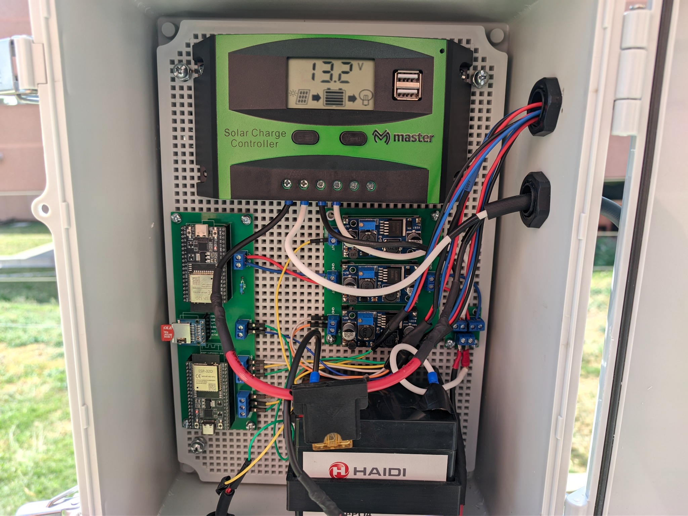
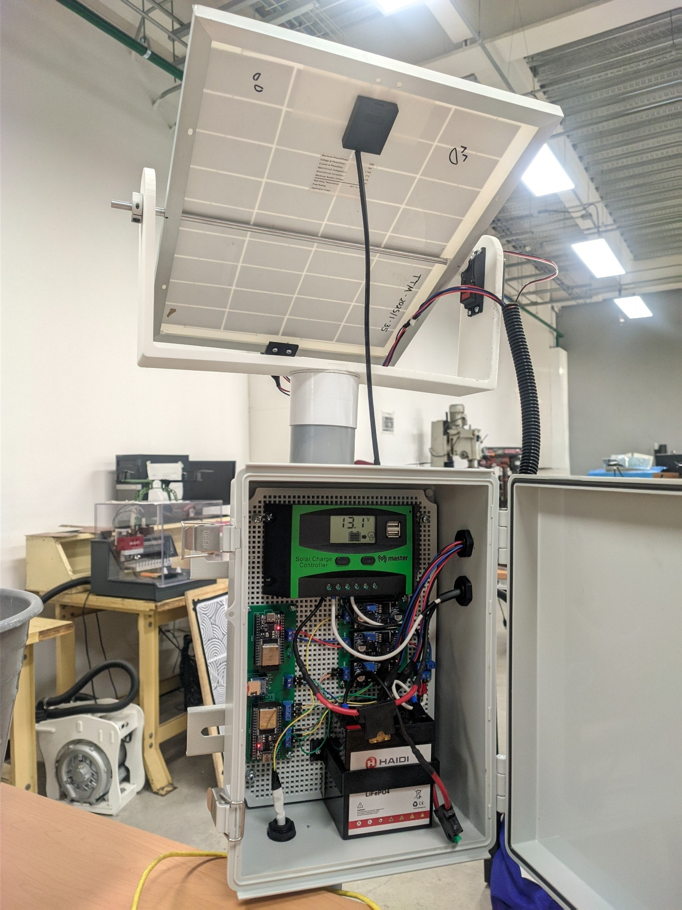
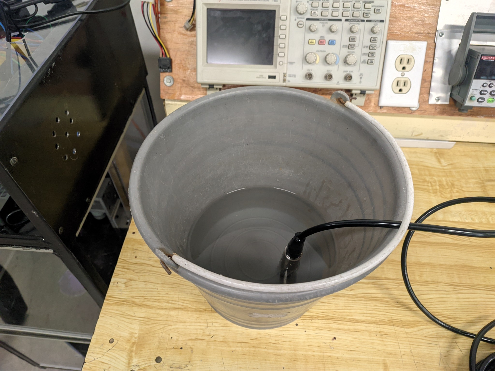
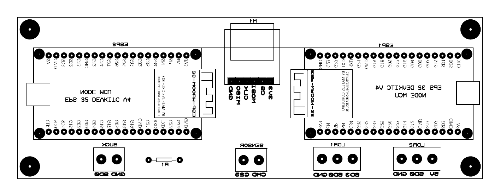
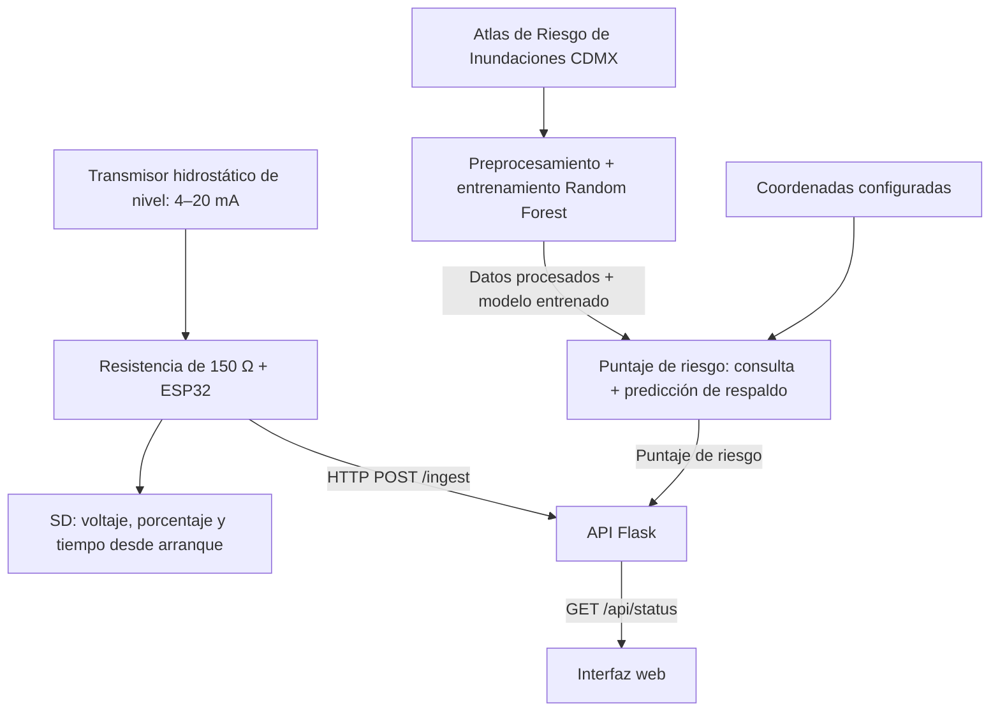

# Monitoreo de inundaciones y predicción de riesgo con ML en CDMX

**ESP32 · Medición hidrostática de nivel · Registro SD · Python/Flask · Regresión Random Forest**

[English](README.md) | Español

Prototipo académico IoT para monitoreo del nivel de agua y estimación del riesgo de inundación mediante aprendizaje automático. Integra un transmisor hidrostático de nivel, adquisición con ESP32 y un modelo de regresión Random Forest; combina el riesgo de la ubicación con las mediciones del sensor para mostrar alertas en una interfaz web.

Desarrollado por un equipo de tres integrantes de Ingeniería Mecatrónica en UPIITA–IPN, desde 2024 hasta la defensa final en enero de 2026. Título académico original: *Sistema de detección de inundaciones con predicción inteligente y sensores IoT*.



*Montaje electrónico y de alimentación del prototipo: controlador de carga, batería, placas ESP32, interfaz SD, convertidores, cableado y fusibles.*

## Trabajo de ingeniería

- **Adquisición:** una ESP32 lee la señal de 4–20 mA de un transmisor hidrostático de nivel de agua mediante una resistencia de 150 Ω, promedia 1000 lecturas ADC y registra voltaje y porcentaje en una tarjeta SD.
- **Integración:** la transmisión HTTP conecta el dispositivo con una API Flask y una interfaz web con mapa y estado de alerta.
- **Prototipo físico:** integración de electrónica, alimentación con batería/solar, gabinete, estructura y seguidor solar de un eje. La memoria final documenta pruebas históricas con agua de 0–55 cm.

### Aportación de Emiliano

| Área | Aportación |
| --- | --- |
| Diseño mecánico | Propuesta principal de estructura, cálculos y CAD; montaje y adaptación del prototipo físico reducido. |
| Electrónica e integración | Diseño e implementación electrónica: selección de componentes, esquemáticos/ruteo de PCB, alimentación, soldadura, cableado y comprobaciones por etapas; ajustes mediante pruebas y revisiones conjuntas. |
| Firmware de adquisición | Desarrollo e implementación del firmware de adquisición del sensor; ajustes posteriores mediante pruebas y revisiones conjuntas. |
| Colaboración | Integración, publicación/documentación del repositorio y participación en cambios de visualización. |

El backend/modelo y el código principal y soporte 3D del seguidor fueron desarrollados principalmente por compañeros.

<details>
<summary>Vista del prototipo, prueba con agua y distribución de componentes de PCB</summary>



*Panel, mecanismo de seguimiento y gabinete electrónico abierto del prototipo.*



*Transmisor hidrostático de nivel de agua en el montaje de prueba.*



*Distribución de componentes de PCB: dos huellas para módulos ESP32, interfaz SD y puntos de conexión. Es un dibujo de colocación; las notas del material detallan su procedencia.*

[Abrir el PDF vectorial](docs/assets/pcb-component-layout.pdf) · [Procedencia y preparación del material](docs/assets/README.md)

</details>

## Recorrido de los datos



El componente predictivo utiliza un regresor Random Forest entrenado con datos procesados del [Atlas de Riesgo de Inundaciones de CDMX](https://datos.cdmx.gob.mx/es/dataset/atlas-de-riesgo-inundaciones). Sus entradas son latitud/longitud; su objetivo es un puntaje de riesgo calculado a partir de categorías de intensidad de precipitación y área inundable. Durante la operación, el software primero busca un registro cercano en el dataset; cuando no encuentra coincidencia, el modelo entrenado predice el puntaje. Las reglas de alerta combinan la categoría de riesgo resultante con los niveles 0–3 del sensor.

El firmware espera **10 segundos después de cada ciclo**, además del tiempo de adquisición/red. La web consulta cada **2 segundos**. El firmware publicado transmite voltaje y porcentaje, en lugar de una altura continua en centímetros.

## Demostración local del software

La revisión local reportó una configuración funcional con Python 3.12.14 y las dependencias directas de [requirements-review-py312.txt](requirements-review-py312.txt). Difiere del [requirements.txt](requirements.txt) original: NumPy 1.26.4 y scikit-learn 1.7.2, versión de entrenamiento reportada por el modelo serializado. No es un bloqueo completo de todas las versiones del entorno.

```bash
git clone https://github.com/aleemireyhdz-star/TT2.git
cd TT2
python -m venv .venv
```

PowerShell, utilizando Python 3.12:

```powershell
.\.venv\Scripts\python.exe -m pip install -r requirements-review-py312.txt
.\.venv\Scripts\python.exe -m flask --app src/Flask_Server.py run --host 127.0.0.1 --port 5000
```

En macOS/Linux, utiliza `.venv/bin/python` para los mismos comandos. Abre `http://127.0.0.1:5000`. La demostración puede recibir lecturas de ejemplo sin ESP32; el mapa carga recursos externos de Leaflet/OpenStreetMap.

Envía una lectura simulada desde otra terminal. En PowerShell:

```powershell
Invoke-RestMethod -Method Post -Uri http://127.0.0.1:5000/ingest -ContentType "application/json" -Body '{"v":0.78,"pct":7.5}'
Invoke-RestMethod -Uri http://127.0.0.1:5000/api/status
```

En una terminal de macOS/Linux:

```bash
curl -X POST http://127.0.0.1:5000/ingest -H "Content-Type: application/json" -d '{"v":0.78,"pct":7.5}'
curl http://127.0.0.1:5000/api/status
```

El ejemplo introduce una lectura simulada. El voltaje corresponde al nivel 2; el color depende de la zona configurada. No ejercita ADC, SD o comunicación inalámbrica.

La ubicación se configura manualmente (sin GPS) y los umbrales de voltaje se obtuvieron con pruebas de altura de agua sobre el prototipo. Una réplica necesita coordenadas explícitas y umbrales medidos propios; consulta las [notas bilingües de hardware y replicación](docs/replication-notes.md).

Para una implementación física, configura localmente la placa, Wi-Fi y servidor en [Sensor.ino](Sensor.ino), y evita incluir credenciales en nuevos commits.

## Comprobaciones y alcance

El repositorio documenta el prototipo presentado en enero de 2026 y, por separado, las mejoras posteriores de software.

| Evidencia | Alcance |
| --- | --- |
| Prototipo histórico | El equipo confirma la compilación del firmware y la operación física para la defensa. Las fotos y la memoria final documentan el montaje y las pruebas con agua. |
| Comprobaciones de software posteriores a la defensa | **21 métodos de prueba Python con subcasos y 3 pruebas JavaScript** aprobados en el entorno Linux registrado: validación de API, transiciones de estado y lógica de la interfaz. |
| Evaluación de Random Forest | La repetición del entrenamiento obtuvo **R² 0.6944** y **RMSE 5.5829 puntos del score** con la partición aleatoria documentada y el objetivo de riesgo calculado. |

El modelo predice un puntaje de riesgo calculado a partir de los indicadores del atlas; no cuenta con validación de campo que establezca pronóstico de inundaciones futuras, probabilidad calibrada o anticipación. La suite automatizada reciente no cubre renderizado en navegador ni telemetría física.

[Ejecutar las pruebas de software](docs/api-validation.md) · [Registro detallado de verificación](docs/verification.md) · [Supuestos de hardware y replicación](docs/replication-notes.md)

## Explorar la implementación

- [Adquisición con ESP32](Sensor.ino)
- [API Flask](src/Flask_Server.py)
- [Predicción del puntaje de riesgo y reglas de alerta](src/Realtime.py)
- [Procesamiento de datos](src/procesar_dataset.py) y [entrenamiento de Random Forest](src/Modelo.py)
- [Scripts históricos de diagnóstico](tests/) — revisar las notas de verificación antes de interpretar sus salidas.
- **Fuente pública de datos:** [Atlas de riesgo – Inundaciones](https://datos.cdmx.gob.mx/es/dataset/atlas-de-riesgo-inundaciones), publicado por la Secretaría de Gestión Integral de Riesgos y Protección Civil (SGIRPC) en Datos Abiertos CDMX. Los datos públicos se procesan para calcular el puntaje de riesgo y entrenar el modelo de esta implementación.
