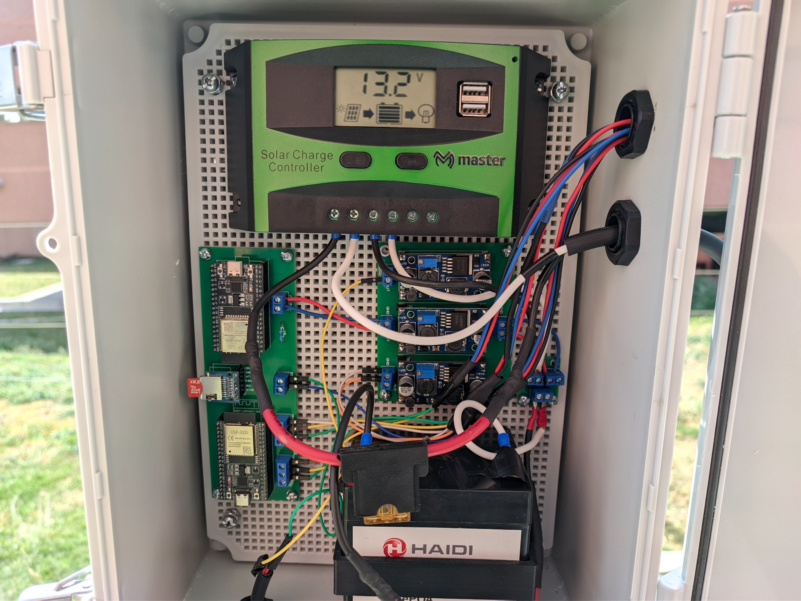
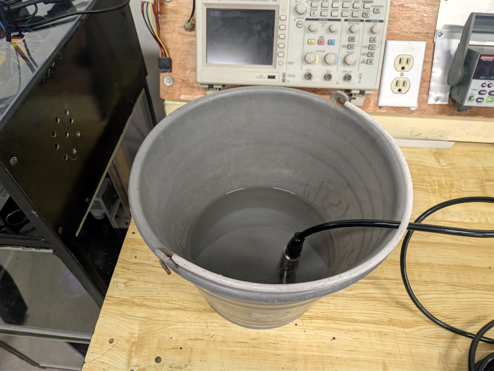
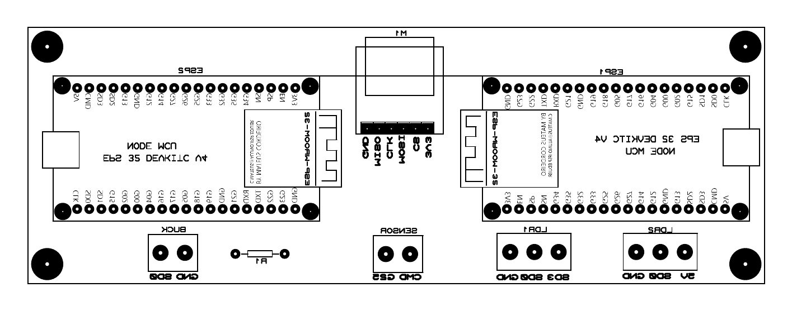
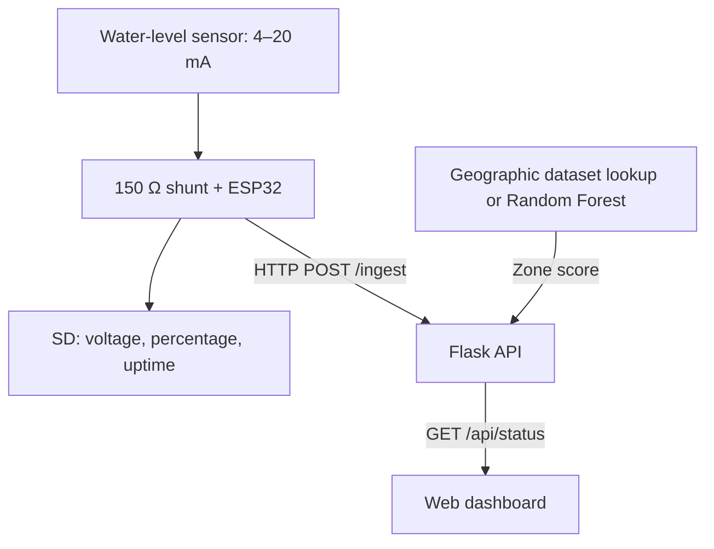

# CDMX Flood Monitoring & Geographic Risk Assessment

**ESP32 · 4–20 mA sensing · SD logging · Python/Flask · geographic risk scoring**

English | [Español](README.es.md)

An academic IoT prototype that connects a water-level sensor to a web dashboard. The system combines a geographic risk score with the current sensor level to display an alert.

Developed by a three-person Mechatronics Engineering team at UPIITA–IPN, from 2024 through the final defense in January 2026. Original academic title: *Sistema de detección de inundaciones con predicción inteligente y sensores IoT*.



*Team prototype: charge controller, battery, ESP32 boards, SD interface, power converters and wiring. The photograph documents the assembly; it does not establish autonomy or the software revision loaded.*

## Engineering work

- **Acquisition:** an ESP32 measures a 4–20 mA sensor through a 150 Ω shunt, averages 1,000 ADC readings, and records voltage and percentage to an SD card.
- **Integration:** HTTP telemetry connects the embedded device to a Flask API and a web dashboard with a map and alert state.
- **Physical prototype:** the team integrated electronics, battery/solar power, an enclosure, a support structure, and a one-axis solar tracker. The final report documents water tests over 0–55 cm; these are historical team results.

### Emiliano's contribution

| Area | Contribution |
| --- | --- |
| Mechanical design | Main proposed support design, calculations and CAD work; assembly and adaptation of the reduced physical prototype. |
| Electronics and integration | Initial component selection, schematics/routing, power integration, soldering, wiring and staged checks; later revisions were shared. |
| Acquisition firmware | Initial sensor-acquisition implementation, followed by collaborative changes and final changes by a teammate. |
| Collaboration | Integration work, repository publication/documentation and participation in visualization changes. |

The backend/ML implementation and the main solar-tracker code and 3D support were primarily teammates' work. This repository presents the team system while identifying Emiliano's contribution.

<details>
<summary>Water-test setup and PCB component placement</summary>



*Water-level sensor in a laboratory container. This image records a test arrangement, rather than a measured height, calibration curve or uncertainty result.*



*PCB component-placement export showing two ESP32 module footprints, an SD interface and connection points. This is a placement drawing, not a complete electrical schematic. The source drawing's orientation is retained.*

[Open the vector PDF](docs/assets/pcb-component-layout.pdf) · [Media provenance and preparation](docs/assets/README.md)

</details>

## Data path



The geographic score uses coordinates and a project-derived dataset. The sensor voltage is classified into levels 0–3; rules combine this level with the geographic category.

The firmware waits **10 seconds after each cycle**, in addition to acquisition/network time. The dashboard polls every **2 seconds**. The published firmware transmits voltage and percentage, rather than a continuous water height in centimeters.

## Run a local software demonstration

The local review reported a working Python 3.12.14 configuration with the direct dependencies in [requirements-review-py312.txt](requirements-review-py312.txt). It differs from the original [requirements.txt](requirements.txt): NumPy is 1.26.4 and scikit-learn is 1.7.2, matching the serialized model's reported training version. It is not a complete environment lock.

```bash
git clone https://github.com/aleemireyhdz-star/TT2.git
cd TT2
python -m venv .venv
```

PowerShell, with Python 3.12:

```powershell
.\.venv\Scripts\python.exe -m pip install -r requirements-review-py312.txt
.\.venv\Scripts\python.exe -m flask --app src/Flask_Server.py run --host 127.0.0.1 --port 5000
```

On macOS/Linux, use `.venv/bin/python` for the same install and Flask commands. Open `http://127.0.0.1:5000`. The software demo can receive example readings without an ESP32; the map uses external Leaflet/OpenStreetMap resources.

Example HTTP requests, using `curl.exe` in Windows PowerShell:

```bash
curl -X POST http://127.0.0.1:5000/ingest -H "Content-Type: application/json" -d '{"v":0.78,"pct":7.5}'
curl http://127.0.0.1:5000/api/status
```

This example supplies a simulated reading. Its voltage maps to sensor level 2; the alert color depends on the configured zone. It does not exercise the ADC, SD card or wireless link.

For physical operation, configure the board, Wi-Fi and server connection in [Sensor.ino](Sensor.ino) locally, and keep connection credentials out of future commits. Compilation for the historical board configuration remains pending.

## Verification and scope

The **20 October 2026 local review** of academic commit `98920f9` reported:

| Check | Reported result |
| --- | --- |
| Flask routes and voltage levels | 13 explicit level/threshold checks matched the expected levels. |
| Re-run of the published training script | R² **0.6944**, MSE **31.1683**, RMSE **5.5829 score points**, using a 244/62 train/test split. |
| ESP32 compilation | Blocked before compiler execution; compilation success was not established. |

The model estimates a constructed geographic score. These metrics do **not** measure future-flood forecasting, probability calibration or lead time. The previous README's R²≈0.85+ was not corroborated.

See [verification details and open issues](docs/verification.md) for environments, API edge cases, test limitations and evidence status. Browser interaction, physical telemetry and field performance were not revalidated in that review.

## Explore the implementation

- [ESP32 acquisition](Sensor.ino)
- [Flask API](src/Flask_Server.py)
- [Geographic scoring and alert rules](src/Realtime.py)
- [Dataset processing](src/procesar_dataset.py) and [model training](src/Modelo.py)
- [Historical diagnostic scripts](tests/) — see the verification notes before interpreting their output.

The final report describes Atlas de Riesgos / SGIRPC / CDMX open-data material as background and the model data as synthetic/derived. The exact source export and transformation history still need documentation.

## License documentation

The original README referenced MIT, but the reviewed snapshot contains no corresponding `LICENSE` file. The license text and dataset/media terms need clarification. This documentation update introduces no new license.
