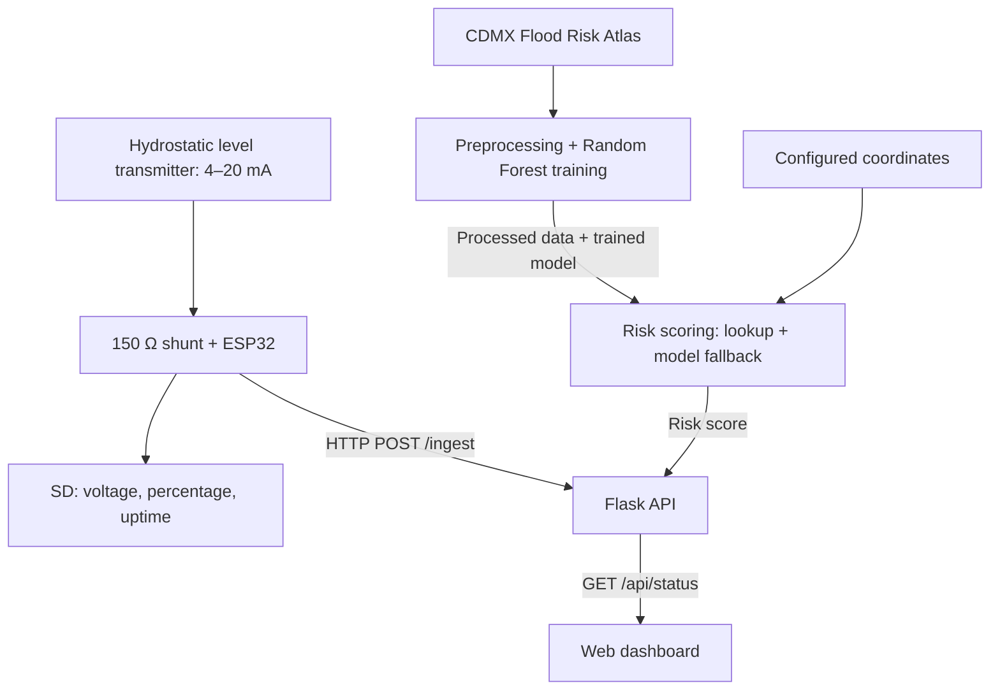

# CDMX Flood Monitoring & ML-Based Risk Prediction

**ESP32 · Hydrostatic level sensing · SD logging · Python/Flask · Random Forest regression**

English | [Español](README.es.md)

An academic IoT prototype for water-level monitoring and flood-risk estimation using machine learning. It integrates a hydrostatic level transmitter, ESP32 acquisition and a Random Forest regression model, combining location risk with sensor measurements to display alerts on a web dashboard.

Developed by a three-person Mechatronics Engineering team at UPIITA–IPN, from 2024 through the final defense in January 2026. Original academic title: *Sistema de detección de inundaciones con predicción inteligente y sensores IoT*.


*Electronics and power assembly of the prototype: charge controller, battery, ESP32 boards, SD interface, power converters, wiring and fuses.*

## Engineering work

- **Acquisition:** an ESP32 reads a hydrostatic water-level transmitter's 4–20 mA signal through a 150 Ω shunt, averages 1,000 ADC readings, and records voltage and percentage to an SD card.
- **Integration:** HTTP telemetry connects the embedded device to a Flask API and a web dashboard with a map and alert state.
- **Physical prototype:** integration of electronics, battery/solar power, an enclosure, a support structure, and a one-axis solar tracker. The final report documents historical water tests over 0–55 cm.

### Emiliano's contribution

| Area | Contribution |
| --- | --- |
| Mechanical design | Main proposed support design, calculations and CAD work; assembly and adaptation of the reduced physical prototype. |
| Electronics and integration | Electronic design and implementation: component selection, schematics/PCB routing, power integration, soldering, wiring and staged checks; refinements made through joint testing and review. |
| Acquisition firmware | Development and implementation of the sensor-acquisition firmware; subsequent refinements made through joint testing and review. |
| Collaboration | Integration work, repository publication/documentation and participation in visualization changes. |

The backend/ML implementation and the main solar-tracker code and 3D support were primarily developed by teammates.

<details>
<summary>Prototype overview, water-test setup and PCB component placement</summary>


*Panel, tracking mechanism and open electronics enclosure of the prototype.*


*Hydrostatic water-level transmitter in the water-test setup.*


*PCB component placement: two ESP32 module footprints, an SD interface and connection points. This export is a placement drawing; see the media notes for source details.*

[Open the vector PDF](docs/assets/pcb-component-layout.pdf) · [Media provenance and preparation](docs/assets/README.md)

</details>

## Data path



The predictive component uses a Random Forest regressor trained on processed data from the [CDMX Flood Risk Atlas](https://datos.cdmx.gob.mx/es/dataset/atlas-de-riesgo-inundaciones). Its inputs are latitude/longitude; its target is a risk score calculated from rainfall-intensity and floodable-area categories. During operation, the software first looks for a nearby dataset record; when no match exists, the trained model predicts the score. Alert rules combine the resulting risk category with sensor levels 0–3.

The firmware waits **10 seconds after each cycle**, in addition to acquisition/network time. The dashboard polls every **2 seconds**. The published firmware transmits voltage and percentage, rather than a continuous water height in centimeters.

## Run a local software demonstration

The local review reported a working Python 3.12.14 configuration with the direct dependencies in [requirements-review-py312.txt](requirements-review-py312.txt). It differs from the original [requirements.txt](requirements.txt): NumPy is 1.26.4 and scikit-learn is 1.7.2, matching the serialized model's reported training version. It is not a complete environment lock.

```bash
git clone https://github.com/aleemireyhdz-star/TT2.git
cd TT2
python -m venv .venv
```

PowerShell, with Python 3.12:

```powershell
.\.venv\Scripts\python.exe -m pip install -r requirements-review-py312.txt
.\.venv\Scripts\python.exe -m flask --app src/Flask_Server.py run --host 127.0.0.1 --port 5000
```

On macOS/Linux, use `.venv/bin/python` for the same install and Flask commands. Open `http://127.0.0.1:5000`. The software demo can receive example readings without an ESP32; the map uses external Leaflet/OpenStreetMap resources.

Send a simulated reading from a second terminal. In PowerShell:

```powershell
Invoke-RestMethod -Method Post -Uri http://127.0.0.1:5000/ingest -ContentType "application/json" -Body '{"v":0.78,"pct":7.5}'
Invoke-RestMethod -Uri http://127.0.0.1:5000/api/status
```

In a macOS/Linux shell:

```bash
curl -X POST http://127.0.0.1:5000/ingest -H "Content-Type: application/json" -d '{"v":0.78,"pct":7.5}'
curl http://127.0.0.1:5000/api/status
```

This example supplies a simulated reading. Its voltage maps to sensor level 2; the alert color depends on the configured zone. It does not exercise the ADC, SD card or wireless link.

The location is configured manually (no GPS), and the voltage thresholds were obtained from water-height experiments on the prototype. A replica needs explicit coordinates and its own measured thresholds; see the bilingual [hardware and replication notes](docs/replication-notes.md).

For a physical implementation, configure the board, Wi-Fi and server connection in [Sensor.ino](Sensor.ino) locally, and keep connection credentials out of future commits.

## Verification and scope

The repository documents the January 2026 prototype and later software improvements separately.

| Evidence | Scope |
| --- | --- |
| Historical prototype | The project team confirms firmware compilation and physical operation for the defense. Photos and the final report document the assembly and water tests. |
| Post-defense software checks | **21 Python test methods with subtests and 3 JavaScript tests** passed in the recorded Linux environment, exercising API validation, state transitions and dashboard logic. |
| Random Forest evaluation | Re-running the training script gave **R² 0.6944** and **RMSE 5.5829 score points** for the documented random split and calculated risk target. |

The model predicts a risk score calculated from the atlas indicators; it has no field validation establishing future-flood forecasting, calibrated probability or lead time. The recent automated suite does not cover browser rendering or physical telemetry.

[Run the software checks](docs/api-validation.md) · [Detailed verification record](docs/verification.md) · [Hardware and replication assumptions](docs/replication-notes.md)

## Explore the implementation

- [ESP32 acquisition](Sensor.ino)
- [Flask API](src/Flask_Server.py)
- [Predictive risk scoring and alert rules](src/Realtime.py)
- [Dataset processing](src/procesar_dataset.py) and [Random Forest training](src/Modelo.py)
- [Historical diagnostic scripts](tests/) — see the verification notes before interpreting their output.
- **Public data source:** [Atlas de riesgo – Inundaciones](https://datos.cdmx.gob.mx/es/dataset/atlas-de-riesgo-inundaciones), published by the Secretaría de Gestión Integral de Riesgos y Protección Civil (SGIRPC) through CDMX Open Data. The public source data is processed for this implementation's risk-score calculation and model training.
