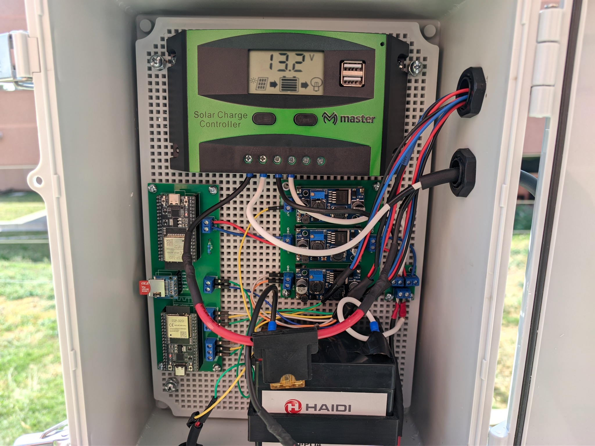
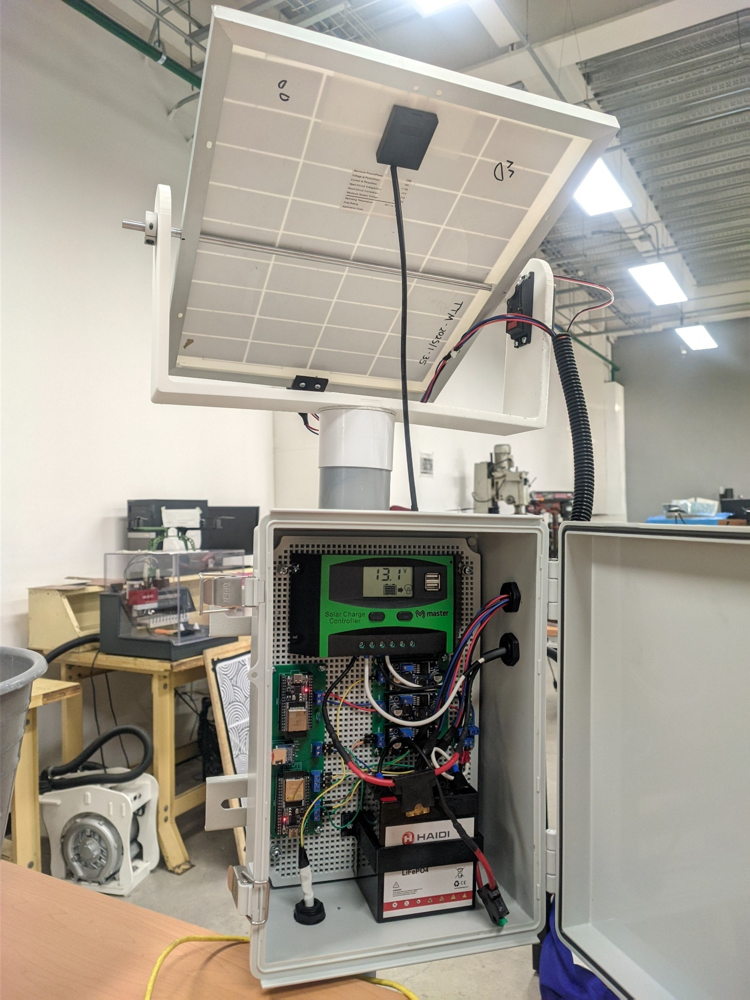
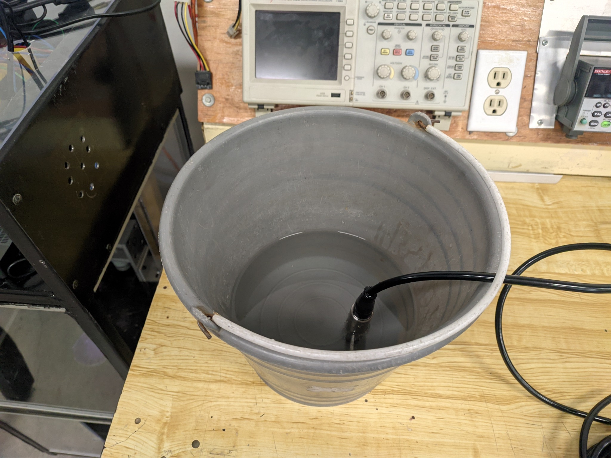
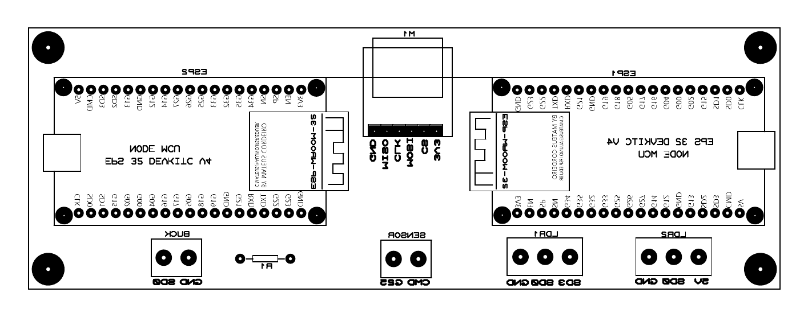
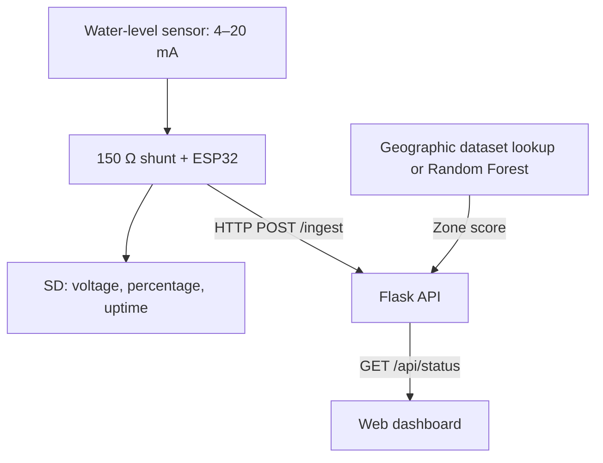

# CDMX Flood Monitoring & Geographic Risk Assessment

**ESP32 · 4–20 mA sensing · SD logging · Python/Flask · geographic risk scoring**

English | [Español](README.es.md)

An academic IoT prototype that connects a water-level sensor to a web dashboard. The system combines a geographic risk score with the current sensor level to display an alert.

Developed by a three-person Mechatronics Engineering team at UPIITA–IPN, from 2024 through the final defense in January 2026. Original academic title: *Sistema de detección de inundaciones con predicción inteligente y sensores IoT*.



*Electronics and power assembly of the team prototype: charge controller, battery, ESP32 boards, SD interface, power converters and wiring.*

## Engineering work

- **Acquisition:** an ESP32 measures a 4–20 mA sensor through a 150 Ω shunt, averages 1,000 ADC readings, and records voltage and percentage to an SD card.
- **Integration:** HTTP telemetry connects the embedded device to a Flask API and a web dashboard with a map and alert state.
- **Physical prototype:** the team integrated electronics, battery/solar power, an enclosure, a support structure, and a one-axis solar tracker. The final report documents water tests over 0–55 cm; these are historical team results.

### Emiliano's contribution

| Area | Contribution |
| --- | --- |
| Mechanical design | Main proposed support design, calculations and CAD work; assembly and adaptation of the reduced physical prototype. |
| Electronics and integration | Initial component selection, schematics/routing, power integration, soldering, wiring and staged checks; later revisions were shared. |
| Acquisition firmware | Initial sensor-acquisition implementation, followed by collaborative changes and final changes by a teammate. |
| Collaboration | Integration work, repository publication/documentation and participation in visualization changes. |

The backend/ML implementation and the main solar-tracker code and 3D support were primarily teammates' work. This repository presents the team system while identifying Emiliano's contribution.

<details>
<summary>Prototype overview, water-test setup and PCB component placement</summary>



*Panel, tracking mechanism and open electronics enclosure of the laboratory prototype.*



*Water-level sensor immersed in a laboratory test container.*



*PCB component placement: two ESP32 module footprints, an SD interface and connection points. This export is a placement drawing; see the media notes for source details.*

[Open the vector PDF](docs/assets/pcb-component-layout.pdf) · [Media provenance and preparation](docs/assets/README.md)

</details>

## Data path



The geographic score uses coordinates and a project-derived dataset. The sensor voltage is classified into levels 0–3; rules combine this level with the geographic category.

The firmware waits **10 seconds after each cycle**, in addition to acquisition/network time. The dashboard polls every **2 seconds**. The published firmware transmits voltage and percentage, rather than a continuous water height in centimeters.

## Run a local software demonstration

The local review reported a working Python 3.12.14 configuration with the direct dependencies in [requirements-review-py312.txt](requirements-review-py312.txt). It differs from the original [requirements.txt](requirements.txt): NumPy is 1.26.4 and scikit-learn is 1.7.2, matching the serialized model's reported training version. It is not a complete environment lock.

```bash
git clone https://github.com/aleemireyhdz-star/TT2.git
cd TT2
python -m venv .venv
```

PowerShell, with Python 3.12:

```powershell
.\.venv\Scripts\python.exe -m pip install -r requirements-review-py312.txt
.\.venv\Scripts\python.exe -m flask --app src/Flask_Server.py run --host 127.0.0.1 --port 5000
```

On macOS/Linux, use `.venv/bin/python` for the same install and Flask commands. Open `http://127.0.0.1:5000`. The software demo can receive example readings without an ESP32; the map uses external Leaflet/OpenStreetMap resources.

Send a simulated reading from a second terminal. In PowerShell:

```powershell
Invoke-RestMethod -Method Post -Uri http://127.0.0.1:5000/ingest -ContentType "application/json" -Body '{"v":0.78,"pct":7.5}'
Invoke-RestMethod -Uri http://127.0.0.1:5000/api/status
```

In a macOS/Linux shell:

```bash
curl -X POST http://127.0.0.1:5000/ingest -H "Content-Type: application/json" -d '{"v":0.78,"pct":7.5}'
curl http://127.0.0.1:5000/api/status
```

This example supplies a simulated reading. Its voltage maps to sensor level 2; the alert color depends on the configured zone. It does not exercise the ADC, SD card or wireless link.

The original prototype was dismantled after the defense. Its location was configured manually (no GPS), and its voltage thresholds came from water-height experiments on that assembly. A replica needs explicit coordinates and its own measured thresholds; see the bilingual [prototype history and replication notes](docs/replication-notes.md).

For a future physical replica, configure the board, Wi-Fi and server connection in [Sensor.ino](Sensor.ino) locally, and keep connection credentials out of future commits. The exact historical board profile/build log has not been recovered.

## Verification and scope

The repository preserves the January 2026 team prototype and documents later software improvements separately.

| Evidence | Scope |
| --- | --- |
| Historical prototype | The owner confirms compilation and physical operation for the defense. Photos and the team report document the assembly and water tests. |
| Post-defense software checks | **21 Python test methods with subtests and 3 JavaScript tests** passed in the recorded Linux environment, exercising API validation, state transitions and dashboard logic. |
| Geographic model review | Re-running the training script gave **R² 0.6944** and **RMSE 5.5829 score points** for the documented random split and constructed geographic target. |

The model estimates a project-derived geographic score; it has no field validation establishing future-flood forecasting, calibrated probability or lead time. The original prototype has been dismantled, so new physical tests on that assembly are unavailable. The recent automated suite does not cover browser rendering or physical telemetry.

[Run the software checks](docs/api-validation.md) · [Detailed verification record](docs/verification.md) · [Hardware and replication assumptions](docs/replication-notes.md)

## Explore the implementation

- [ESP32 acquisition](Sensor.ino)
- [Flask API](src/Flask_Server.py)
- [Geographic scoring and alert rules](src/Realtime.py)
- [Dataset processing](src/procesar_dataset.py) and [model training](src/Modelo.py)
- [Historical diagnostic scripts](tests/) — see the verification notes before interpreting their output.

The final report describes Atlas de Riesgos / SGIRPC / CDMX open-data material as background and the model data as synthetic/derived. The exact source export and transformation history still need documentation.

## License documentation

The original README referenced MIT, but the reviewed snapshot contains no corresponding `LICENSE` file. The license text and dataset/media terms need clarification. This documentation update introduces no new license.
